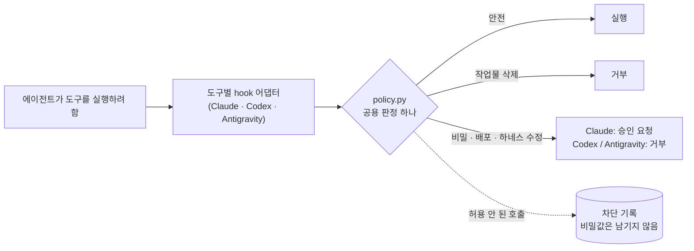

<div align="center">

# 통합 마스터 하네스 (Unified Master Harness)

**정책 하나. 스킬 여섯 개. 실제로 작동하는 안전 hook.**<br>
**Claude Code**, **Codex**, **Antigravity**가 함께 쓰는 작업 하네스. 실제 CLI로 측정했습니다.

[](https://github.com/egoxx1/unified-master-harness/actions/workflows/ci.yml)
[](LICENSE)
[](#요구-사항)
[](#요구-사항)
[](CHANGELOG.md)

[English](README.md) · **한국어**

</div>

---

## 왜 필요한가

코딩 에이전트는 유능하지만 들쭉날쭉합니다. 같은 요청에도 한 줄 수정이 나오기도 하고 대규모 리팩터링이 나오기도 합니다. 테스트를 돌리기도 하고, 아무것도 확인하지 않은 채 자신 있게 "완료"라고 하기도 합니다. 무해한 `git status`를 실행하기도 하고, 작업물을 날리는 `git reset --hard`를 실행하기도 합니다. 게다가 도구마다 설정 형식이 다릅니다.

이 하네스는 세 에이전트에게 **같은 규칙**을 주고, 위험한 부분은 **각 CLI가 실제로 실행하는 hook**으로 막습니다.

- **작업 크기에 맞는 절차.** 작은 수정은 작게 끝내고, 큰 작업은 수용 기준부터 정합니다.
- **"완료" 전에 검증.** 에이전트는 자기 변경을 확인해야 하고, 확인하지 않으면 Claude Code가 경고합니다.
- **실제로 막히는 안전장치.** 작업물을 날리는 명령, 비밀 파일, 외부 배포, 하네스 자체 수정은 차단하거나 승인을 받게 합니다.

## 한눈에 보기

| | Claude Code | Codex | Antigravity |
|---|:---:|:---:|:---:|
| 공통 정책 (`AGENTS.md`) | ✓ `CLAUDE.md` 경유 | ✓ 기본 지원 | ✓ 자동 생성 사본 |
| 필요할 때만 읽는 스킬 6개 | ✓ | ✓ | ✓ |
| 작업물을 날리는 명령 | 거부 | 거부 | 거부 |
| 비밀 파일·외부 배포·하네스 수정 | 승인 요청 | 거부 | 거부 |
| 비밀 파일을 보호하는 OS 샌드박스 | ✓ | 작업 폴더 샌드박스 | — |
| 검증 경고, 문맥 압축 후 기억 | ✓ | — | — |

Codex와 Antigravity의 hook은 승인 창을 안정적으로 띄우지 못하기 때문에, 사람이 판단해야 하는 일은 거부합니다.

## 동작 방식



| 계층 | 파일 | 역할 |
|---|---|---|
| 제품 기준 | `PROJECT.md` | 제품이 무엇이고 절대 깨지면 안 되는 것 (직접 작성) |
| 작업 정책 | `AGENTS.md` | 에이전트가 작업 크기를 정하고, 고치고, 검증하고, 멈추는 방식 (51줄, 약 2,400토큰) |
| 절차 | `.agents/skills/` | 작업에 맞을 때만 읽는 스킬 6개 |
| 강제 | `agent-core/hooks/` | 공용 정책 하나와 CLI별 작은 어댑터 |
| 도구별 연결 | `.claude/` `.codex/` `.agents/hooks.json` | hook, 권한, 샌드박스 |
| 도구 | `agent-core/scripts/` | 설치, 업그레이드, 점검, smoke 테스트, 평가 |

## 빠른 시작

```bash
git clone https://github.com/egoxx1/unified-master-harness.git
python3 unified-master-harness/install/apply.py --target /경로/내-저장소            # 미리보기
python3 unified-master-harness/install/apply.py --target /경로/내-저장소 --apply --create-project-template
```

그다음 내 저장소에서:

```bash
python3 agent-core/scripts/bootstrap_project.py --write   # 명령·포트를 근거로만 기록
python3 agent-core/scripts/install_git_hooks.py           # 커밋할 때 비밀 파일 차단
python3 agent-core/scripts/doctor.py                      # 하네스를 약하게 만드는 사용자 설정 찾기
```

Codex(`/hooks`)와 Antigravity에서 폴더를 한 번 신뢰한 뒤 **[START-HERE.ko.md](START-HERE.ko.md)**를 읽으세요.

> **이미 `AGENTS.md`, `CLAUDE.md`, 에이전트 설정이 있나요?** 설치 프로그램은 아무것도 쓰지 않고 종료 코드 2로 멈춥니다.
> [install/INSTALLATION-PROMPT.md](install/INSTALLATION-PROMPT.md)를 에이전트에게 주면 의미 단위로 합쳐 줍니다.
> 내 `README.md`, 제품 코드, `PROJECT.md`는 절대 건드리지 않습니다.

## 측정 결과

모든 수치는 이 저장소의 스크립트를 실제로 실행한 결과입니다(v4.2.1, 2026년 10월).

| 검사 | Claude Code 2.1.296 | Antigravity 1.3.3 | Codex CLI 0.161–0.165 |
|---|:---:|:---:|:---:|
| 실제 CLI 안전 smoke | **6/6** | **6/6** | **8/8**³ |
| Claude 전용 계층 (샌드박스·권한·생명주기) | **8/8** | — | — |
| 모델 없이 hook 런타임 검사 | — | — | **통과**² |
| 스킬 선택 12건 | **12/12** | **12/12** | **12/12**, 각 3회⁴ |
| CI: macOS·Linux × Python 3.10 / 3.12 / 3.13 | | **6/6 통과** | |

⁴ 12건 모두 3회 연속 통과(36/36), Codex CLI 0.165.0, 2026-10-30. ² 실제 Codex CLI를 로컬 가짜 모델로 구동했고, hook을 뺀 반대 실험은 예상대로 실패했습니다. ³ v4.3.0, Codex CLI 0.165.0, 실제 모델(2026-10-30): 공통 검사 6개와 Codex 전용 `apply_patch`·빈 `bash` 탐침 2개.

**비용, 있는 그대로.** 작은 작업 4개를 Claude Code로 24회 돌린 결과, 하네스를 쓰면 쓰지 않을 때보다 **약 42% 더** 들었고 정답률은 양쪽 모두 100%였습니다. 늘어난 비용으로 얻는 것: 어려운 작업에서 에이전트가 테스트를 **9/9**번 실행했고(하네스 없이는 0/9), 버그를 고칠 때마다 재발 방지 테스트를 남겼습니다(**6/6**, 하네스 없이는 0/6). 턴마다 입력 약 4,900토큰은 고정 문맥이고, 그중 절반가량은 Claude Code 자체의 샌드박스 설명입니다. 토큰을 줄이고 싶다면 벤치마크 문서에 약 +20%로 되돌리는 설정 두 가지가 있습니다.

→ [검증 보고서](docs/VERIFICATION-REPORT.md) · [벤치마크와 비용 줄이는 방법](docs/BENCHMARK.md) (영어)

## 무엇을 막나

<details>
<summary><b>작업물을 날리는 명령</b> (모든 CLI에서 거부)</summary>

`git reset --hard`, `git checkout -- .`, `git restore .`, `git switch --discard-changes`, `git stash clear/drop`, `git clean -f`, 강제 push, 홈·시스템 루트에 대한 `rm -rf`. `sh -c`, `eval`, `sudo`, `env`, `xargs`, `timeout`이나 `-C` 같은 git 전역 옵션 뒤에 숨겨도 잡습니다.
</details>

<details>
<summary><b>비밀 파일</b></summary>

`.env`와 그 변형, 개인 키(`*.pem`, `*.key`, `id_rsa` 등), `.netrc`, `.pgpass`, `.git-credentials`, kubeconfig, Docker·GitHub CLI 인증 파일. 읽기·복사·인코딩·전송 모두 해당합니다. `.env.example`은 읽을 수 있습니다.
</details>

<details>
<summary><b>외부 작업</b></summary>

`git push`, 패키지 배포(`npm publish`, `twine upload` 등), `gh release`, 배포(Vercel, Netlify, Fly, Firebase, Wrangler 등), `terraform apply`, `kubectl apply`, `helm upgrade`, `docker push`, `aws s3` 쓰기, 데이터베이스 파괴 명령.
</details>

<details>
<summary><b>하네스 자체 수정</b></summary>

셸로 `AGENTS.md`, `CLAUDE.md`, hook, 스크립트, 평가, 도구 설정을 고치는 것. Claude Code에서 편집 도구로 고치려 하면 승인을 요청합니다.
</details>

## 스킬

| 스킬 | 쓰는 때 |
|---|---|
| `project-context` | 명령·실행 환경·구조를 모르거나 오래됐을 때 |
| `dev-plan` | 크거나 모호하거나 여러 영역에 걸친 작업, 제품 수준 작업의 코딩 전 |
| `dev-debug` | 버그, 실패하는 테스트, 크래시, 회귀 |
| `dev-ui-verify` | 화면이 보이는 방식이나 동작을 바꾸는 모든 변경 (변경 크기에 맞춘 깊이) |
| `dev-verify` | 코드·설정·스키마 변경을 완료라고 말하기 전 |
| `dev-review` | 요청받았을 때, 또는 위험도 높은 변경 |

## 도구

| 명령 | 하는 일 |
|---|---|
| `install/apply.py` | 저장소에 설치. 기존 에이전트 설정은 덮어쓰지 않음 |
| `agent-core/scripts/upgrade_harness.py` | 업그레이드. 직접 고친 파일은 유지하고 충돌은 `.v4-new`로 둠 |
| `agent-core/scripts/doctor.py` | 사용자 설정과 커밋된 비밀 파일을 읽기 전용으로 점검 |
| `agent-core/scripts/provider_smoke.py` | 일회용 저장소에서 실제 CLI로 무해한 검사 실행 |
| `agent-core/scripts/codex_hook_probe.py` | 계정·사용량 없이 Codex hook 확인 |
| `agent-core/scripts/run_evals.py` | 에이전트가 맞는 스킬을 고르는지 측정 |
| `bench/run_bench.py` | 하네스 유무에 따른 비용·품질 벤치마크 |

## 요구 사항

- macOS 또는 Linux (Windows는 WSL 사용, 네이티브 Windows는 검증 안 됨)
- Python 3.10 이상, git. 다른 의존성 없음.
- Claude Code, Codex CLI, Antigravity CLI 중 하나 이상.

## 현재 상태: 완성품이 아니라 검증된 출발점

위의 내용은 모두 측정한 것이지만, 아직 측정하지 못한 것도 있습니다. 일부러 여기에 적어 둡니다.

1. **스킬 선택 평가는 너그럽습니다.** 필수 스킬과 금지 스킬만 봅니다. 여백 한 줄 수정에 Codex가 3회 모두 `dev-debug`를 골라도 통과했는데, 지금은 해당 사례에서 금지하고 정책도 이를 막습니다(Codex·Claude Code 모두 12/12, 각 3회).
2. **큰 작업에서는 아직 하네스가 값을 하지 못했습니다.** 여러 파일을 고치는 과제 2개(`cart`, `listing`)에서 양쪽 모두 6/6 정답이었고 테스트도 돌렸으며, 하네스 쪽 비용이 약 20% 더 들었습니다. 불필요한 `dev-debug`와 profile 읽기를 없앴지만 전체 비용은 2%만 줄었습니다. 남은 비용 대부분은 턴마다 붙는 고정 문맥과 테스트입니다.
3. **평가를 한 번 통과해도 흔들림이 숨어 있을 수 있습니다.** 사례 하나를 6번 반복했더니, 12건을 한 번 돌릴 때는 보이지 않던 실패(6번 중 2번)가 나왔습니다. 다른 사례도 실행마다 달라질 수 있습니다.
4. **안전장치는 방화벽이 아닙니다.** 변수로 출력하는 비밀값, 표준입력으로 넘기는 대상, 변수로 만든 경로는 보지 못합니다. 코드가 맞는지는 여전히 테스트와 에이전트의 검증·리뷰에 달려 있고, 이것도 놓칠 수 있습니다. 하네스는 검증을 건너뛰는 것을 불가능하게 만드는 게 아니라 드러나게 만듭니다.
5. **실제 사용 기록이 아직 없습니다.** 성장 엔진은 차단 기록과 회고를 바탕으로 하네스를 개선하는데, 이 기록은 실제 작업을 해야 쌓입니다.

**토대는 마련해 두었습니다. 잘 길들여서 본인의 것으로 만드세요.** 작업하다 막히거나 에이전트가 이상하게 행동하면 `/retro`(Claude Code)나 `growth_engine.py`로 기록해 두세요. 그 기록이 다음 개선의 근거가 됩니다.

## 기여

Pull request를 환영합니다. 정책을 바꿀 때는 막히는지 확인하는 테스트와, 비슷한 일상 명령은 계속 실행되는지 확인하는 테스트가 둘 다 필요합니다. 스킬을 바꿀 때는 전후 평가 점수가 필요합니다. [CONTRIBUTING.md](CONTRIBUTING.md)를 보세요. 우회 방법은 [SECURITY.md](SECURITY.md)에 따라 비공개로 신고해 주세요.

## 라이선스와 감사의 말

[MIT](LICENSE). openai/codex, openai/openai-agents-python, vercel/next.js, obra/superpowers, addyosmani/agent-skills, multica-ai/andrej-karpathy-skills, jbarbier/CLAUDE.md의 아이디어를 참고했고, 참고한 버전은 `agent-core/sources.lock.json`에 있습니다.
