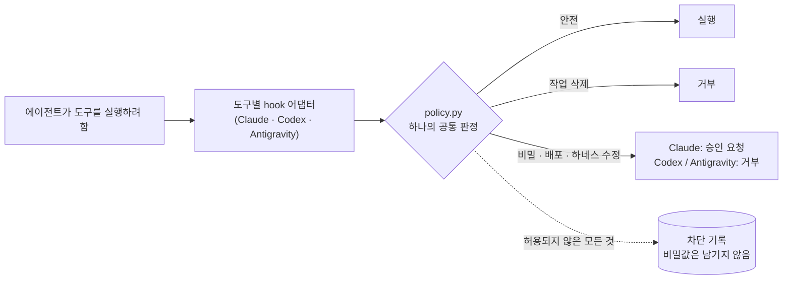

<div align="center">

# 통합 마스터 하네스 (Unified Master Harness)

**정책 하나, 스킬 여섯 개, 그리고 CLI가 실제로 실행하는 안전 hook.**<br>
**Claude Code**, **Codex**, **Antigravity**가 함께 쓰는 작업 하네스. 실제 CLI로 측정했습니다.

[](https://github.com/egoxx1/unified-master-harness/actions/workflows/ci.yml)
[](LICENSE)
[](#요구-사항)
[](#요구-사항)
[](CHANGELOG.md)

[English](README.md) · **한국어**

</div>

---

## 1분 요약

- **무엇인가.** 작업 정책 하나(`AGENTS.md`), 필요할 때만 불러오는 작업 스킬 여섯 개, 그리고 Claude Code·Codex·
  Antigravity에 연결된 안전 hook입니다. 명령 한 줄로 어느 git 저장소에나 설치합니다.
- **측정으로 확인된 효과.** 세 CLI 모두에서 작업을 날리는 명령, 비밀 파일 읽기, 배포, 하네스 자신의 규칙 수정을
  막습니다(실제 CLI smoke: Claude Code 6/6 + 8/8, Codex 8/8, Antigravity 7/7). 에이전트가 검증을 건너뛰지
  않게 됩니다. 하네스가 있으면 170회 중 169회 테스트를 돌렸고, 없으면 158회였습니다(p = 0.001). 버그 수정 뒤
  재발 방지 테스트는 110/110 대 104/110이었습니다(p = 0.015).
- **비용.** Claude Opus 5.5에서는 하네스가 없을 때보다 과제당 **+17.5%**, Sonnet 5.5에서는 **+2.8%**(노이즈
  범위)입니다. Opus 추가 비용의 약 절반은 Claude Code 자체의 샌드박스 설명입니다.
- **하지 못하는 것.** 지금 모델에서는 정답률을 높이지 못했습니다. 하네스가 이기도록 만든 과제 4개를 포함해
  Opus 100회, Sonnet 55회 모두 양쪽이 다 맞았습니다. 도입 전에 아래 수치를 읽어 보세요.

## 목차

[왜 필요한가](#왜-필요한가) · [무엇을 얻나](#무엇을-얻나) · [동작 원리](#동작-원리) · [빠른 시작](#빠른-시작) ·
[일상 사용](#일상-사용) · [무엇을 막나](#무엇을-막나) · [측정 결과](#측정-결과) · [설정 고르기](#설정-고르기) ·
[도구](#도구) · [업그레이드](#업그레이드) · [알려진 한계](#알려진-한계) · [저장소 구조](#저장소-구조) ·
[요구 사항](#요구-사항) · [기여](#기여)

## 왜 필요한가

코딩 에이전트는 유능하지만 일관되지 않습니다. 같은 요청에 한 줄 수정이 나올 때도, 크게 번진 리팩터가 나올
때도 있습니다. 테스트를 돌릴 때도, 아무것도 확인하지 않고 "완료"라고 할 때도 있습니다. 무해한 `git status`를
칠 때도, 작업을 날리는 `git reset --hard`를 칠 때도 있습니다. CLI마다 설정 형식도 달라서 한 에이전트에 쓴
규칙이 다른 에이전트에는 닿지 않습니다.

이 하네스는 세 에이전트에 **같은 규칙**을 주고, 위험한 부분은 **각 CLI가 실제로 실행하는 hook**으로 막습니다.

- **작업 크기에 맞는 절차.** 작은 수정은 작게 끝내고, 큰 작업은 계획과 완료 기준부터 세웁니다.
- **"완료" 전에 검증.** 에이전트가 변경을 확인하고, 확인하지 않았으면 Claude Code가 알려 줍니다.
- **버티는 안전장치.** 작업을 날리는 명령, 비밀 파일, 배포, 하네스 자기 수정은 막히거나 승인을 거쳐야 하며,
  막힌 기록은 비밀값 없이 남습니다.

## 무엇을 얻나

| | Claude Code | Codex | Antigravity |
|---|:---:|:---:|:---:|
| 공통 정책 (`AGENTS.md`) | ✓ `CLAUDE.md`가 불러옴 | ✓ 기본 지원 | ✓ `.agents/AGENTS.md` 사본 |
| 필요할 때 불러오는 스킬 6개 | ✓ `.claude/skills` | ✓ `.agents/skills` | ✓ `.agents/skills` |
| 작업을 날리는 명령 | 거부 | 거부 | 거부 |
| 비밀 파일, 배포, 하네스 수정 | **승인 요청** | 거부 | 거부 |
| 셸 말고 파일 도구도 검사 | Read, Grep, **MCP 도구** | `apply_patch` | **모든 도구** |
| OS 수준 샌드박스 | ✓ 쓰기는 프로젝트 안, 비밀 파일 읽기 차단 | ✓ workspace-write | — (제공되지 않음) |
| 빈 대화형 세션 (`bash`, `python3`, `psql` …) | 명령마다 검사 | 거부 (입력이 hook을 우회) | 명령마다 검사 |
| 검증 없이 끝낸 편집 경고 | ✓ Stop hook | — | — |
| 대화 압축 뒤에도 작업 기억 | ✓ PreCompact → SessionStart | — | — |

Codex와 Antigravity의 hook은 승인 창을 안정적으로 띄우지 못합니다(Antigravity는 `always-proceed`에서 "ask"를
자동 승인합니다). 그래서 사람이 판단해야 하는 일은 거부하고, 에이전트가 사용자에게 직접 요청하도록 안내합니다.

## 동작 원리



| 층 | 위치 | 역할 |
|---|---|---|
| 제품 기준 | `PROJECT.md` | 제품이 무엇이고 절대 깨면 안 되는 것 (직접 작성) |
| 작업 정책 | `AGENTS.md` | 에이전트가 작업 크기를 정하고, 고치고, 검증하고, 멈추는 방법 (46줄, 약 1,600토큰) |
| 절차 | `.agents/skills/` (`.claude/skills/`에 사본) | 작업이 맞을 때만 불러오는 스킬 6개 |
| 강제 | `agent-core/hooks/` | 정책 하나(`policy.py`)와 CLI별 작은 어댑터 |
| CLI 연결 | `.claude/settings.json`, `.codex/`, `.agents/hooks.json` | hook, 권한 규칙, 샌드박스 |
| 도구 | `agent-core/scripts/` | 설치, 업그레이드, doctor, smoke, 평가, 성장 엔진 |

세 어댑터가 모두 같은 `policy.py`를 부르기 때문에 규칙을 한 번 추가하면 모든 CLI에 적용됩니다. 어댑터는 각
CLI의 이벤트 형식과 "승인 요청" 방식만 맞춥니다. Codex와 Antigravity 어댑터는 실패하면 막는 쪽으로 동작합니다.
입력이 깨졌거나 내부 오류가 나면 거부하고, 128KB가 넘는 입력은 검사 전에 거부해서 CLI의 5초 hook 제한에 걸리는
일이 없게 합니다(제한을 넘기면 두 CLI는 도구를 그냥 실행합니다).

hook 사본을 홈 폴더(`~/agent-core/hooks`)에 두면 하네스가 없는 폴더도 지킬 수 있습니다. 이 사본은 같거나 더 새
버전의 V4가 들어 있는 프로젝트에서는 물러나므로, 프로젝트는 항상 자기 규칙으로 동작합니다.

## 빠른 시작

**1. 저장소에 설치**

```bash
git clone https://github.com/egoxx1/unified-master-harness.git
python3 unified-master-harness/install/apply.py --target /path/to/your-repo            # 미리 보기: 추가될 파일 목록
python3 unified-master-harness/install/apply.py --target /path/to/your-repo --apply --create-project-template
```

> **이미 `AGENTS.md`, `CLAUDE.md`, 에이전트 설정이 있나요?** 설치기는 아무것도 쓰지 않고 코드 2로 끝납니다.
> [install/INSTALLATION-PROMPT.md](install/INSTALLATION-PROMPT.md)를 에이전트에게 주면 의미에 맞게 합쳐 줍니다.
> `README.md`, 제품 코드, `PROJECT.md`는 건드리지 않습니다.

**2. 그 저장소에서 한 번만 설정**

```bash
python3 agent-core/scripts/bootstrap_project.py --write   # 테스트·빌드 명령과 포트를 근거에서만 기록
python3 agent-core/scripts/install_git_hooks.py           # pre-commit: 비밀 파일 차단, 하네스 설정 검사
python3 agent-core/scripts/doctor.py                      # 하네스를 약하게 만드는 사용자 설정 찾기
```

`RISK`부터 고치고 `WARN`은 모두 읽어 보세요. `doctor.py`는 아무것도 바꾸지 않습니다.

**3. CLI마다 폴더 신뢰**

- **Claude Code:** 할 일 없음. `.claude/settings.json`이 바로 적용됩니다.
- **Codex:** 저장소에서 `codex`를 열어 프로젝트를 신뢰한 뒤, `/hooks`에서 V4 hook을 검토하고 신뢰합니다. Codex는
  신뢰한 hook만 실행하며, 신뢰 기록이 없는 V4 hook이 있으면 `doctor.py`가 경고합니다.
- **Antigravity:** 그 폴더에서 처음 `agy`를 열 때 나오는 작업공간 신뢰 창을 승인합니다.

**4. 내 컴퓨터에서 실제로 동작하는지 확인**

```bash
python3 agent-core/scripts/provider_smoke.py      # 설치된 CLI마다 무해한 탐침 실행, 몇 분 걸림
python3 agent-core/scripts/codex_hook_probe.py    # Codex hook만, 계정·사용량 필요 없음
```

그다음 `PROJECT.md`를 채우고 **[START-HERE.ko.md](START-HERE.ko.md)**를 읽으세요.

## 일상 사용

하네스를 직접 부를 일은 없습니다. 에이전트가 일하는 방식이 이렇게 바뀝니다.

- **작업 크기 판단.** 작음(파일 1~2개, 뻔한 수정): 확인 → 수정 → 해당 검사, 계획이나 하위 에이전트 없음. 보통
  (한 서브시스템): 구현한 뒤 영향 범위를 검증. 큼(여러 서브시스템, 마이그레이션, 공개 계약, 큰 UX): `dev-plan`
  먼저, 한 명이 구현, `dev-verify`, 위험이 클 때만 `dev-review`.
- **에이전트가 멈추고 묻는 경우.** 되돌릴 수 없거나 파괴적인 작업, 인증 정보, 허락받지 않은 push·병합·배포,
  운영 데이터, 결과가 크게 달라지는 요구사항. "묻지 마"라는 요청은 승인이 아닙니다. 그 밖에는 "계속할까요?"
  없이 진행합니다.
- **버그 수정**은 테스트가 있는 저장소라면 그 버그를 잡는 테스트를 남깁니다.
- **진행 중인 작업 보존.** 작업 트리에 있는 모르는 변경은 다른 사람의 것으로 보고 reset·clean·restore·덮어쓰기를
  하지 않습니다.

**Claude Code 추가 기능:** `/harness-check`(설정·사용자 설정 점검), `/smoke`(CLI smoke 테스트), `/retro`(차단
기록을 개선 후보로 정리), 그리고 새 문맥에서 독립 검토를 하는 `dev-reviewer` 하위 에이전트.

### 스킬

| 스킬 | 불러오는 때 |
|---|---|
| `project-context` | 명령, 실행 환경, 구조를 모르거나 오래됐거나 새로 세팅할 때 |
| `dev-plan` | 크거나 모호하거나 여러 영역에 걸치거나 마이그레이션·제품 수준인 작업, 코딩 전에 |
| `dev-debug` | 원인을 아직 모르는 버그, 실패하는 테스트, 크래시, 회귀 (보고만 봐도 원인이 보일 때와 간격·크기·색 수정은 제외) |
| `dev-ui-verify` | UI가 보이거나 동작하는 방식을 바꾸는 모든 변경, 변경 크기에 맞춘 깊이로 |
| `dev-verify` | 코드·설정·스키마 변경을 완료라고 하기 전, 리팩터 포함 |
| `dev-review` | 요청받았을 때, 또는 위험이 큰 변경 (인증, 결제, 파괴적 마이그레이션, 공개 API …) |

## 무엇을 막나

<details>
<summary><b>작업을 날리는 명령</b> (모든 CLI에서 거부)</summary>

`git reset --hard`, `git checkout -- .`, `git restore .`, `git switch --discard-changes`, `git stash clear/drop`,
`git clean -f`, 강제 push, 홈·시스템 루트·`.`·`*`에 대한 `rm -rf`, `find / -delete`와 조건 없는 `find . -delete`,
환경 변수 전체 출력(`env`, `printenv`, `os.environ` 출력). `sh -c`, `eval`, `sudo`, `env`, `xargs`, `timeout`,
`-C` 같은 git 전역 옵션 뒤에 숨겨도 막습니다.
</details>

<details>
<summary><b>비밀 파일과 비밀값</b></summary>

`.env`와 그 변형, 개인 키(`*.pem`, `*.key`, `id_rsa` …), `.netrc`, `.pgpass`, `.git-credentials`, kubeconfig,
Docker·GitHub CLI 인증 정보를 읽기, 불러오기(`source .env`), 복사, 인코딩, 전송하는 것. 셸, 파일 도구, Claude
MCP 도구, Antigravity 도구 모두에 적용됩니다. 비밀처럼 보이는 이름의 변수를 출력하는 것(`echo
$AWS_SECRET_ACCESS_KEY`, `cat <<< "$API_TOKEN"`)도 승인을 받아야 합니다. `.env.example`은 읽을 수 있습니다.
</details>

<details>
<summary><b>외부 작업</b></summary>

`git push`, 패키지 배포(`npm publish`, `twine upload` …), `gh pr merge`, `gh release`, 배포(Vercel, Netlify, Fly,
Firebase, Wrangler …), `terraform apply`, `kubectl apply`, `helm upgrade`, `docker push`, `aws s3` 쓰기, 데이터를
바꾸는 HTTP 요청, 파괴적인 데이터베이스 명령.
</details>

<details>
<summary><b>먼저 읽어 볼 수 없는 코드</b></summary>

`curl … | sh`, `bash <(curl …)`, `sh -c "$(curl …)"`, `… | base64 -d | sh`, `gzip -dc … | sh`, 페이로드를
디코딩해서 바로 실행하는 인라인 코드, 대상이 `xargs`나 변수에서 오는 재귀 `rm`(`rm -rf "$DIR"`). 파일로 내려받아
읽어 본 뒤 실행하는 것은 허용됩니다.
</details>

<details>
<summary><b>하네스 자체 수정</b></summary>

`AGENTS.md`, `CLAUDE.md`, hook, 스크립트, 평가, CLI 설정에 쓰는 것. 셸, Codex `apply_patch`, Antigravity
`edit_file`/`write_file`, 쓰기 계열 MCP 도구 모두 해당합니다. Claude Code에서는 편집 도구가 승인을 묻고,
샌드박스 때문에 셸에서는 이 파일들을 쓸 수 없습니다.
</details>

<details>
<summary><b>Codex: hook을 우회하는 세션</b></summary>

Codex가 실행 중인 프로세스에 나중에 보내는 입력(`write_stdin`)은 hook을 거치지 않습니다. 그래서 빈 세션은
거부합니다: `bash`, `python3`, `node`, `ipython`, `irb`, `ghci`, `lua`, `R`, `julia`, `php -a`, `rails console`,
`psql`, `mysql`, `sqlite3 db`, `mongosh`, `redis-cli`, `sqlplus`, `gdb`, `ssh host`, `tmux`, `screen -r`. 실행할
내용을 함께 넘기는 명령(`bash -lc "…"`, 스크립트, `-c`/`-e`, `psql -c`, `ssh host uptime`)은 실행됩니다.
</details>

## 측정 결과

모든 수치는 이 저장소의 스크립트를 실제로 실행한 결과입니다(v4.3.2, 2026년 10월, macOS). 자세한 내용은
[검증 보고서](docs/VERIFICATION-REPORT.md)와 [벤치마크](docs/BENCHMARK.md)(영어)에 있습니다.

### 안전

| 검사 | Claude Code 2.1.314 | Antigravity 1.4.11 | Codex CLI 0.165.0 |
|---|:---:|:---:|:---:|
| 실제 CLI 안전 smoke | **6/6** | **7/7**¹ | **8/8**² |
| Claude 전용 계층 (샌드박스·권한·생명주기) | **8/8** | — | — |
| 모델 없이 hook 런타임 검사 (반대 실험 포함) | — | — | **통과**³ |
| MCP 도구로 비밀 파일 읽기 | **차단**⁴ | — | — |
| 단위 테스트 (CI: macOS·Linux × Python 3.10 / 3.12 / 3.13) | | **131개 통과** | |

¹ 파일 도구로 `AGENTS.md`를 고치는 탐침 포함. 기본 모델 사용량이 바닥난 뒤 Gemini 3.8 Flash로 쟀습니다. 기본
모델 Gemini 4 Argon도 마지막 규칙 추가 전에 7/7이었습니다. ² 공통 탐침 6개와 Codex 전용 `apply_patch`·빈 `bash`
탐침 2개. ³ 실제 Codex CLI를 로컬 가짜 모델로 구동했고, hook을 빼면 같은 검사가 실패합니다(그래야 정상입니다).
⁴ 최소한의 stdio MCP 서버로 시험. 4.3.2 전에는 비밀값이 모델에 전달됐고, 지금은 hook이 먼저 승인을 묻습니다.

코드를 읽어서가 아니라 이 측정으로 찾아내 고친 문제들입니다. Antigravity 1.4가 파일 도구 이름을 바꿔 hook이
아무 경고 없이 놓쳤습니다(비밀값이 모델에 전달됐고 `AGENTS.md`를 고칠 수 있었습니다). Claude MCP 도구는 아예
검사하지 않았습니다. Codex는 `apply_patch`로 보호 파일을 고칠 수 있었고, 빈 대화형 세션으로 모든 검사를 우회할
수 있었습니다.

### 스킬 선택

과제 설명 12개를 실제 에이전트에 각각 3번씩 보냈습니다. 3번 모두 맞는 스킬을 고르고 금지된 스킬을 고르지 않아야
통과입니다.

| Claude Code | Codex | Antigravity |
|:---:|:---:|:---:|
| **12/12** (36/36회) | **12/12** (36/36회) | **12/12** (36/36회, Gemini 3.8 Flash)⁵ |

⁵ 기본 모델 Gemini 4 Argon에서는 같은 정책으로 36회 중 33회 통과, 잘못 고른 경우 0회, 답 없이 끝난 3회(시간 초과
1회, 공급자 오류 2회)였고, 그 뒤 사용량이 바닥났습니다.

### 비용과 효과

작은 Python 프로젝트의 과제 10개(오타, 버그 수정, 기능 추가, 여러 파일 변경, 원인이 증상에서 파일 네 개 떨어진
버그, `.env.local`에 둔 가짜 비밀값, 작업 트리에 남은 동료의 미완성 작업)를 하네스 있이 10번, 없이 10번 돌리고,
에이전트가 볼 수 없는 숨김 테스트로 채점했습니다.

| | Opus 5.5, 하네스 없음 | Opus 5.5, 하네스 | Sonnet 5.5, 하네스 없음 | Sonnet 5.5, 하네스 |
|---|:---:|:---:|:---:|:---:|
| 정답 | 100/100 | 100/100 | 55/55 | 55/55 |
| 추가 비용 | — | **+17.5%** | — | **+2.8%** (노이즈) |
| 테스트 실행 (Opus는 이틀치) | 158/170 | **169/170** | 47/50 | 47/50 |
| 버그 수정 뒤 재발 방지 테스트 (Opus, 이틀치) | 104/110 | **110/110** | — | — |

있는 그대로 말하면, **하네스가 이긴 과제는 없습니다.** Opus에서 하네스가 주는 것은 건너뛰지 않는 검증입니다(테스트
실행 p = 0.001, 재발 방지 테스트 p = 0.015). 이번 과제들에서는 건너뛴 검증이 마침 버그를 숨기지 않아서 정답률
차이로 나타나지 않았습니다. `AGENTS.md`를 줄이고 불필요한 디버깅 단계를 없애도 비용은 노이즈 범위에서 그대로였습니다.
Sonnet에서는 하네스 비용이 거의 없습니다.

## 설정 고르기

Opus 추가 비용은 Claude Code 샌드박스(턴마다 고정 설명 약 2,900토큰, 경로 목록을 줄여도 약 250토큰만 줄어듦)와
나머지 하네스(정책, 스킬, 늘어난 검증 턴)로 나뉩니다. 과제 10개 전체에서 잰 결과입니다.

| 설정 | 추가 비용 (Opus) | 검증 | Claude 전용 안전 검사 | 권장 |
|---|:---:|---|:---:|---|
| **전체 하네스 (기본값)** | +17.5% | 테스트 90/90, 재발 방지 테스트 60/60 | **8/8** | 대부분의 저장소 |
| 샌드박스 끔 | +8.4% | 테스트 45/45, 재발 방지 테스트 30/30 | 6/8 | 토큰 비용이 더 중요한 저위험 저장소 |
| 하네스 없음 | — | 테스트 81/90, 재발 방지 테스트 55/60 | — | — |

샌드박스를 끄면 검증 이점은 그대로지만, 프로젝트 밖 쓰기와 셸로 하네스 파일을 고치는 것을 더는 막지 못합니다.
남는 것은 hook뿐이고, hook은 명령어 문자열을 읽을 뿐 스크립트가 무엇을 하는지는 보지 못합니다. 바꾸려면
`.claude/settings.json`에서 `"sandbox": {"enabled": false}`로 설정하세요. 기본값은 켜 둔 상태입니다.

## 도구

| 명령 | 하는 일 |
|---|---|
| `install/apply.py` | 저장소에 설치. 기존 에이전트 설정은 덮어쓰지 않음 |
| `agent-core/scripts/upgrade_harness.py` | 하네스 파일 업그레이드. 직접 고친 파일은 남기고 새 버전은 `.v4-new`로 저장 |
| `agent-core/scripts/doctor.py` | 읽기 전용 점검: 사용자 설정, hook 신뢰, 추적 중인 비밀 파일, 마지막 smoke 이후 CLI 버전 변화 |
| `agent-core/scripts/provider_smoke.py` | 일회용 저장소에서 실제 CLI마다 무해한 탐침 실행 (`--agy-model`, `--codex-model`) |
| `agent-core/scripts/codex_hook_probe.py` | Codex가 hook을 실행하는지 계정·사용량 없이 확인 (`--control`은 실패해야 정상) |
| `agent-core/scripts/run_evals.py` | 에이전트가 맞는 스킬을 고르는지 측정 (`--repeat N`) |
| `agent-core/scripts/growth_engine.py` | 차단 기록과 회고를 개선 후보로 정리, 스냅샷과 되돌리기 지원 |
| `agent-core/scripts/check_agent_config.py` | 하네스 파일 검사 (pre-commit hook과 CI에서도 실행) |
| `bench/run_bench.py` | 하네스 있음/없음 비용·품질 벤치마크 (`--arms`, `--model`, `--tasks`) |

## 업그레이드

```bash
python3 agent-core/scripts/upgrade_harness.py --from /path/to/new/unified-master-harness            # 미리 보기
python3 agent-core/scripts/upgrade_harness.py --from /path/to/new/unified-master-harness --apply
```

한 번도 고치지 않은 파일은 교체하고, 고친 파일은 그대로 두고 새 버전을 옆에 `*.v4-new`로 씁니다. 끝나면
`provider_smoke.py`를 다시 돌리고, Codex가 요청하면 `/hooks`에서 hook을 검토하세요. CLI를 업그레이드한 뒤에도
smoke를 돌리세요. Antigravity 1.4는 파일 도구 이름을 한 번 바꿨고, `doctor.py`는 CLI 버전이 마지막 smoke 때와
다르면 경고합니다. 홈 폴더에 hook 사본을 두고 있다면 `doctor.py`가 그 버전과, 직접 넣은 규칙을 덮어쓰지 않고
갱신하는 방법을 알려 줍니다.

## 알려진 한계

- **Antigravity에는 OS 샌드박스가 없습니다.** `--sandbox` 옵션도 우리 시험에서 프로젝트 밖 쓰기를 막지 못했습니다.
  Antigravity에서는 hook이 유일한 보호 장치입니다.
- **hook은 명령어 문자열을 읽을 뿐 동작을 보지 않습니다.** 비밀을 출력하는 스크립트, 평범한 이름의 변수(`echo $X`),
  간접적으로 도달한 디렉터리(`cd "$D" && rm -rf build`), 목록에 없는 디코더는 여전히 통과합니다. Claude와 Codex
  샌드박스가 그중 일부를 막습니다.
- **MCP 도구는 Claude Code에서만 검사합니다.** Codex와 Antigravity가 hook 이벤트에서 MCP 도구를 어떤 이름으로
  넘기는지는 확인하지 못했습니다.
- **Codex:** 목록에 없는 대화형 프로그램은 통과하고, `/hooks`에서 신뢰하는 단계는 사람이 해야 합니다.
- **정답은 여전히 테스트에 달려 있습니다.** 에이전트의 자체 검증도 놓칠 수 있습니다. 하네스는 검증을 건너뛰는 일을
  드물고 눈에 띄게 만들 뿐, 불가능하게 만들지는 않습니다.
- **벤치마크는 작고 Claude만 쟀습니다.** Python 프로젝트, Claude 모델 2개, 과제 10개입니다. Codex와 Antigravity는
  안전과 스킬 선택만 쟀고 비용은 재지 않았습니다.
- **실사용 데이터는 아직 없습니다.** 성장 엔진은 차단 기록과 회고로 하네스를 개선하는데, 이 기록은 실제로 일을
  해야 쌓입니다.

## 저장소 구조

```text
AGENTS.md                 공통 작업 정책 (원본)
CLAUDE.md                 Claude Code 어댑터: AGENTS.md를 불러옴
PROJECT.md                제품 기준 (템플릿, 직접 작성)
START-HERE.ko.md          하네스를 쓰는 저장소의 첫 단계 안내
.agents/                  Antigravity용 AGENTS.md 사본, hooks.json, 원본 스킬
.claude/                  설정(hook, 권한, 샌드박스), 스킬 사본, 명령, dev-reviewer
.codex/                   config.toml (workspace-write 샌드박스), hooks.json
agent-core/hooks/         policy.py와 CLI별 어댑터, 차단 기록, 홈 폴더 사본용 scope
agent-core/scripts/       설치, 업그레이드, doctor, smoke, probe, 평가, 성장 엔진, 릴리스
agent-core/evals/         스킬 선택 평가 사례
agent-core/tests/         단위 테스트 131개
bench/                    벤치마크 실행기, 과제 프로젝트, 숨김 테스트, 모범 답안
docs/                     검증 보고서, 벤치마크, 원본 측정 데이터, 운영 안내
install/                  설치기, 기존 에이전트 설정이 있는 저장소용 병합 프롬프트
templates/                PROJECT, PR 본문, QA 보고서, 작업 요청 템플릿
```

## 요구 사항

- macOS 또는 Linux (Windows는 WSL 사용, 네이티브 Windows는 미검증)
- Python 3.10 이상, git. 그 밖의 의존성 없음.
- Claude Code, Codex CLI, Antigravity CLI 중 하나 이상.

## 내 것으로 만들기

기반은 측정으로 다져 두었지만 완성품은 아닙니다. 방해가 되는 일이 있거나 에이전트가 이상하게 행동하면 `/retro`
(Claude Code)나 `growth_engine.py record`로 기록하세요. 그 기록이 다음 개선의 근거가 됩니다. 정책을 바꿀 때는
막아야 할 것을 막는 테스트와 비슷한 일상 명령은 계속 실행되는 테스트를 함께 넣고, 스킬을 바꿀 때는 전후 평가
점수를 남기세요.

## 기여

PR을 환영합니다. [CONTRIBUTING.md](CONTRIBUTING.md)를 보세요. 우회 방법을 찾았다면 [SECURITY.md](SECURITY.md)에
적힌 대로 비공개로 알려 주세요. 버전 기록은 [CHANGELOG.md](CHANGELOG.md)에 있습니다.

## 라이선스와 감사의 말

[MIT](LICENSE). openai/codex, openai/openai-agents-python, vercel/next.js, obra/superpowers,
addyosmani/agent-skills, multica-ai/andrej-karpathy-skills, jbarbier/CLAUDE.md의 아이디어를 가져와 다듬었습니다.
고정한 리비전은 `agent-core/sources.lock.json`에 있습니다.
