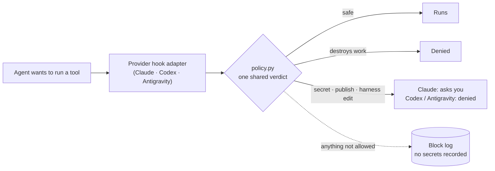

<div align="center">

# Unified Master Harness

**One policy. Six skills. Safety hooks that the CLIs actually run.**<br>
A shared operating harness for **Claude Code**, **Codex** and **Antigravity**, measured on the real CLIs.

[](https://github.com/egoxx1/unified-master-harness/actions/workflows/ci.yml)
[](LICENSE)
[](#requirements)
[](#requirements)
[](CHANGELOG.md)

**English** · [한국어](README.ko.md)

</div>

---

## In one minute

- **What it is.** One work policy (`AGENTS.md`), six on-demand workflow skills, and safety hooks wired into
  Claude Code, Codex and Antigravity. Install it into any git repository with one command.
- **What it measurably does.** Blocks work-destroying commands, secret reads, publishing and edits of its own
  rules on all three CLIs (real-CLI smoke tests: Claude Code 6/6 + 8/8, Codex 8/8, Antigravity 7/7). Agents
  stop skipping verification: with the harness they ran the tests in 169 of 170 runs, without it 158 of 170
  (p = 0.001), and left a regression test after 110/110 bug fixes versus 104/110 (p = 0.015).
- **What it costs.** On Claude Opus 5.5, **+17.5%** per task over no harness; on Sonnet 5.5, **+2.8%** (within
  noise). About half of the Opus overhead is Claude Code's own sandbox text; the sandbox is now off by default
  (+8.4% measured), see [Choosing a configuration](#choosing-a-configuration).
- **What it does not do.** On current models it did not make answers more correct: both sides were correct in
  every one of 100 Opus and 55 Sonnet runs, including four tasks built to favor the harness. Read the
  numbers below before deciding.

## Contents

[Why](#why) · [What you get](#what-you-get) · [How it works](#how-it-works) · [Quick start](#quick-start) ·
[Daily use](#daily-use) · [What gets blocked](#what-gets-blocked) · [Measured results](#measured-results) ·
[Choosing a configuration](#choosing-a-configuration) · [Tooling](#tooling) · [Upgrading](#upgrading) ·
[Known limits](#known-limits) · [Repository layout](#repository-layout) · [Requirements](#requirements) ·
[Contributing](#contributing)

## Why

Coding agents are capable but inconsistent. The same request can produce a one-line fix or a sprawling
refactor; a test run or a confident "done" with nothing checked; a harmless `git status` or a
`git reset --hard` that discards your work. Each CLI also has its own configuration format, so rules written
for one agent do not reach the others.

This harness gives all three agents **the same rules** and backs the dangerous parts with **hooks each CLI
actually executes**:

- **Process that scales with the task.** Small edits stay small; large work starts with a plan and
  acceptance criteria.
- **Verification before "done".** Agents check their change; Claude Code warns you when one did not.
- **Guard rails that hold.** Work-destroying commands, secret files, publishing and self-modification are
  blocked or need your approval, and every block is logged without recording secrets.

## What you get

| | Claude Code | Codex | Antigravity |
|---|:---:|:---:|:---:|
| Shared policy (`AGENTS.md`) | ✓ imported by `CLAUDE.md` | ✓ native | ✓ mirrored to `.agents/AGENTS.md` |
| Six on-demand skills | ✓ `.claude/skills` | ✓ `.agents/skills` | ✓ `.agents/skills` |
| Work-destroying commands | denied | denied | denied |
| Secret files, publishing, harness edits | **asks you** | denied | denied |
| Checks file tools, not just the shell | Read, Grep, **MCP tools** | `apply_patch` | **every tool** |
| OS-level sandbox | off by default (opt-in: writes limited to the project) | ✓ workspace-write | — (none available) |
| Bare interactive sessions (`bash`, `python3`, `psql` …) | checked per command | denied (input bypasses hooks) | checked per command |
| Warning when an edit was never verified | ✓ Stop hook | — | — |
| Memory across context compaction | ✓ PreCompact → SessionStart | — | — |

Codex and Antigravity hooks cannot reliably show an approval prompt (Antigravity auto-approves "ask" under
`always-proceed`), so everything that needs a human is denied there and the agent is told to ask you instead.

## How it works



| Layer | Where | Role |
|---|---|---|
| Product truth | `PROJECT.md` | What the product is and must never break (you write it) |
| Work policy | `AGENTS.md` | How agents size, change, verify and stop (46 lines, about 1,600 tokens) |
| Procedures | `.agents/skills/` (mirrored to `.claude/skills/`) | Six skills, loaded only when the task matches |
| Enforcement | `agent-core/hooks/` | One policy (`policy.py`) and one small adapter per CLI |
| Provider wiring | `.claude/settings.json`, `.codex/`, `.agents/hooks.json` | Hooks, permission rules, sandboxes |
| Tooling | `agent-core/scripts/` | Install, upgrade, doctor, smoke tests, evals, growth engine |

All three adapters call the same `policy.py`, so a rule added once applies everywhere. Each adapter only
translates the CLI's event format and its idea of "ask". The Codex and Antigravity adapters fail closed: bad
input or an internal error produces a deny, and input over 128 KB is denied before parsing so a check can
never run into the CLI's 5-second hook timeout (after which those CLIs run the tool anyway).

A copy of the hooks can also live in your home folder (`~/agent-core/hooks`) to guard folders without a
harness. It steps aside for any project that ships an equal or newer V4 version, so projects always run their
own rules.

## Quick start

**1. Install into a repository**

```bash
git clone https://github.com/egoxx1/unified-master-harness.git
python3 unified-master-harness/install/apply.py --target /path/to/your-repo            # dry run: lists files
python3 unified-master-harness/install/apply.py --target /path/to/your-repo --apply --create-project-template
```

> **Already have `AGENTS.md`, `CLAUDE.md` or agent settings?** The installer writes nothing and exits with
> code 2. Hand [install/INSTALLATION-PROMPT.md](install/INSTALLATION-PROMPT.md) to an agent to merge them by
> meaning. Your `README.md`, product code and `PROJECT.md` are never touched.

**2. Set it up once, in that repository**

```bash
python3 agent-core/scripts/bootstrap_project.py --write   # record test/build commands and ports from evidence
python3 agent-core/scripts/install_git_hooks.py           # pre-commit: block secret files, check harness config
python3 agent-core/scripts/doctor.py                      # find user-level settings that weaken the harness
```

Fix `RISK` findings first and read every `WARN`; `doctor.py` never changes anything.

**3. Let each CLI trust the folder**

- **Claude Code:** nothing to do; `.claude/settings.json` applies immediately.
- **Codex:** open `codex` in the repository, trust the project, then review and trust the V4 hooks in `/hooks`.
  Codex runs only hooks it has trusted; `doctor.py` warns while a V4 hook has no trust record.
- **Antigravity:** approve the workspace-trust prompt the first time you open `agy` there.

**4. Prove it works on your machine**

```bash
python3 agent-core/scripts/provider_smoke.py      # each installed CLI against harmless probes, a few minutes
python3 agent-core/scripts/codex_hook_probe.py    # Codex hooks only, no account or usage needed
```

Then fill in `PROJECT.md` and read **[START-HERE.md](START-HERE.md)**.

## Daily use

You do not call the harness; it shapes how agents work. What changes in practice:

- **Task sizing.** Small (1–2 files, obvious): inspect → edit → targeted check, no plan or subagents. Medium
  (one subsystem): implement, then verify what is affected. Large (cross-subsystem, migration, public
  contract, significant UX): `dev-plan` first, one owner implements, `dev-verify`, and `dev-review` only when
  the risk justifies it.
- **When agents stop and ask.** Irreversible or destructive operations, credentials, push / merge / publish /
  deploy you have not authorized, production data, and requirements with materially different outcomes. A
  request that says "don't ask me" is not approval. Everything else continues without "should I continue?".
- **Bug fixes** in a repository with tests leave a test that covers the bug.
- **Your work in progress is preserved.** Unknown changes in the tree are treated as someone else's: no
  reset, clean, restore or overwrite.

**Claude Code extras:** `/harness-check` (configuration and user-settings audit), `/smoke` (provider smoke
test), `/retro` (turns block logs into improvement candidates), and a `dev-reviewer` subagent for an
independent review with fresh context.

### Skills

| Skill | Loaded when |
|---|---|
| `project-context` | Commands, runtime or layout are unknown, stale or being bootstrapped |
| `dev-plan` | Large, ambiguous, cross-cutting, migration or product-level work, before coding |
| `dev-debug` | A bug, failing test, crash or regression whose cause is not yet known (not when the report already shows the cause, and not for spacing/size/color fixes) |
| `dev-ui-verify` | Any change to how the UI looks or behaves, with depth scaled to the change |
| `dev-verify` | Before claiming any code, config or schema change complete, refactors included |
| `dev-review` | On request, or for high-risk changes (auth, payments, destructive migrations, public APIs …) |

## What gets blocked

<details>
<summary><b>Work-destroying commands</b> (denied on every CLI)</summary>

`git reset --hard`, `git checkout -- .`, `git restore .`, `git switch --discard-changes`, `git stash
clear/drop`, `git clean -f`, force push, `rm -rf` on home, system roots, `.` or `*`, `find / -delete` and
unfiltered `find . -delete`, broad environment dumps (`env`, `printenv`, `os.environ` printed) — also when
hidden behind `sh -c`, `eval`, `sudo`, `env`, `xargs`, `timeout` or git global options such as `-C`.
</details>

<details>
<summary><b>Secret files and values</b></summary>

`.env` and its variants, private keys (`*.pem`, `*.key`, `id_rsa` …), `.netrc`, `.pgpass`,
`.git-credentials`, kubeconfig, Docker and GitHub CLI credentials — reading, loading (`source .env`), copying,
encoding or sending them, through the shell, file tools, Claude MCP tools or Antigravity tools. Printing a
credential-named variable (`echo $AWS_SECRET_ACCESS_KEY`, `cat <<< "$API_TOKEN"`) asks too. `.env.example`
stays readable.
</details>

<details>
<summary><b>External actions</b></summary>

`git push`, package publishing (`npm publish`, `twine upload` …), `gh pr merge`, `gh release`, deploys
(Vercel, Netlify, Fly, Firebase, Wrangler …), `terraform apply`, `kubectl apply`, `helm upgrade`,
`docker push`, `aws s3` writes, mutating HTTP requests and destructive database statements.
</details>

<details>
<summary><b>Code the guard cannot read first</b></summary>

`curl … | sh`, `bash <(curl …)`, `sh -c "$(curl …)"`, `… | base64 -d | sh`, `gzip -dc … | sh`, inline code
that decodes and executes a payload, and recursive `rm` whose targets come from `xargs` or a variable
(`rm -rf "$DIR"`). Downloading to a file, reading it and then running it stays allowed.
</details>

<details>
<summary><b>Changes to the harness itself</b></summary>

Writes to `AGENTS.md`, `CLAUDE.md`, the hooks, scripts, evals and provider configuration — from the shell,
Codex `apply_patch`, Antigravity `edit_file`/`write_file` and write-type MCP tools. In Claude Code the edit
tool and shell writes ask for your approval (with the opt-in sandbox, these files are also unwritable from the shell).
</details>

<details>
<summary><b>Codex: sessions that would bypass the hook</b></summary>

Input that Codex later sends to a running process (`write_stdin`) never reaches a hook, so bare sessions are
denied: `bash`, `python3`, `node`, `ipython`, `irb`, `ghci`, `lua`, `R`, `julia`, `php -a`, `rails console`,
`psql`, `mysql`, `sqlite3 db`, `mongosh`, `redis-cli`, `sqlplus`, `gdb`, `ssh host`, `tmux`, `screen -r`.
Commands that carry their own input (`bash -lc "…"`, scripts, `-c`/`-e`, `psql -c`, `ssh host uptime`) run.
</details>

## Measured results

Every number comes from a real run of the scripts in this repository, v4.3.2, October 2026, macOS.
Full details: [verification report](docs/VERIFICATION-REPORT.md) and [benchmark](docs/BENCHMARK.md).

### Safety

| Check | Claude Code 2.1.314 | Antigravity 1.4.11 | Codex CLI 0.165.0 |
|---|:---:|:---:|:---:|
| Safety smoke on the real CLI | **6/6** | **7/7**¹ | **8/8**² |
| Claude-only layer (sandbox, permissions, lifecycle) | **8/8** | — | — |
| Hook runtime without a model, with negative control | — | — | **PASS**³ |
| Secret read through an MCP tool | **blocked**⁴ | — | — |
| Unit tests (CI: macOS + Linux × Python 3.10 / 3.12 / 3.13) | | **131 passing** | |

¹ Includes editing `AGENTS.md` with the file tool. On Gemini 3.8 Flash after the default model's quota ran
out; the default Gemini 4 Argon also passed 7/7 before the last rule additions. ² The six shared probes plus
the Codex-only `apply_patch` and bare-`bash` probes. ³ Real Codex CLI driven by a local stand-in model; with
the hooks removed the same probe fails, as it must. ⁴ Through a minimal stdio MCP server: before 4.3.2 the
secret reached the model, now the hook asks first.

Found and fixed by these measurements, not by reading code: Antigravity 1.4 renamed its file tools and the
hook silently missed them (a secret reached the model; file edits of `AGENTS.md` were possible); Claude MCP
tools were not checked at all; Codex could edit protected files through `apply_patch` and bypass every check
through bare interactive sessions.

### Skill routing

Twelve task descriptions, each sent three times to the real agent; a case passes only if all three runs pick
the right skills and none of the forbidden ones.

| Claude Code | Codex | Antigravity |
|:---:|:---:|:---:|
| **12/12** (36/36 runs) | **12/12** (36/36 runs) | **12/12** (36/36 runs, Gemini 3.8 Flash)⁵ |

⁵ With the default Gemini 4 Argon the same policy had 33 of 36 runs pass, no wrong choice, and 3 runs without
an answer (one timeout, two provider errors) before its quota ran out.

### Cost and value

Ten tasks on small Python projects — typo, bug fixes, features, multi-file changes, a symptom four files from
its cause, a fake secret in `.env.local`, a teammate's unfinished work in the tree — each run 10 times with and
10 times without the harness, scored by hidden tests the agent never sees.

| | Opus 5.5, no harness | Opus 5.5, harness | Sonnet 5.5, no harness | Sonnet 5.5, harness |
|---|:---:|:---:|:---:|:---:|
| Correct | 100/100 | 100/100 | 55/55 | 55/55 |
| Extra cost | — | **+17.5%** | — | **+2.8%** (noise) |
| Ran the tests (two days, Opus) | 158/170 | **169/170** | 47/50 | 47/50 |
| Left a regression test after a bug fix (two days, Opus) | 104/110 | **110/110** | — | — |

Stated plainly: **the harness did not win a task.** What it buys on Opus is verification that is not skipped
(p = 0.001 for running the tests, p = 0.015 for regression tests); on these tasks the skipped checks happened
not to hide a bug, so it did not show up as correctness. A shorter `AGENTS.md` and dropping a needless debugging
step left the cost unchanged within noise. On Sonnet the harness costs almost nothing.

## Choosing a configuration

The Opus overhead splits into the Claude Code sandbox (about 2,900 tokens of fixed text per turn; trimming its
path lists saves only about 250) and the rest of the harness (policy, skills, the extra verification turns).
Measured on all ten tasks:

| Configuration | Extra cost (Opus) | Verification | Claude-only safety checks | Recommended for |
|---|:---:|---|:---:|---|
| Full harness, sandbox on | +17.5% | tests 90/90, regression tests 60/60 | **8/8** | Repositories where shell writes outside the project must be stopped |
| **Sandbox off (default)** | +8.4% | tests 45/45, regression tests 30/30 | 6/8 | Most repositories; the sandbox blocked too much ordinary work |
| No harness | — | tests 81/90, regression tests 55/60 | — | — |

With the sandbox off the verification benefit stays, but writes outside the project and shell edits of the
harness's own files are no longer stopped; only the hooks remain, and they read command text, not what a script
does. The default is off, with Bash, edits and web tools allowed without prompts (deny and ask rules still win).
To turn the sandbox back on, set `"sandbox": {"enabled": true}` in `.claude/settings.json` and remove the
broad `permissions.allow` rules if you want prompts again.

## Tooling

| Command | What it does |
|---|---|
| `install/apply.py` | Installs into a repository; refuses to overwrite existing agent configuration |
| `agent-core/scripts/upgrade_harness.py` | Upgrades harness-owned files; keeps your edits, writes conflicts as `.v4-new` |
| `agent-core/scripts/doctor.py` | Read-only audit: user settings, hook trust, tracked secrets, CLI versions since the last smoke test |
| `agent-core/scripts/provider_smoke.py` | Runs each real CLI against harmless probes in a disposable repository (`--agy-model`, `--codex-model`) |
| `agent-core/scripts/codex_hook_probe.py` | Checks that Codex runs the hooks, with no account or usage (`--control` must fail) |
| `agent-core/scripts/run_evals.py` | Measures whether an agent picks the right skills (`--repeat N`) |
| `agent-core/scripts/growth_engine.py` | Turns block logs and retrospectives into improvement candidates, with snapshots and rollback |
| `agent-core/scripts/check_agent_config.py` | Validates the harness files (also run by the pre-commit hook and CI) |
| `bench/run_bench.py` | With/without-harness cost and quality benchmark (`--arms`, `--model`, `--tasks`) |

## Upgrading

```bash
python3 agent-core/scripts/upgrade_harness.py --from /path/to/new/unified-master-harness            # preview
python3 agent-core/scripts/upgrade_harness.py --from /path/to/new/unified-master-harness --apply
```

Files you never changed are replaced; files you changed are kept and the new version is written next to them as
`*.v4-new`. Afterwards run `provider_smoke.py` again, and in Codex review the hooks in `/hooks` if it asks.
Run the smoke test after every CLI upgrade too: Antigravity 1.4 renamed its file tools once, and `doctor.py`
warns when a CLI version differs from the last one tested. If you keep a copy of the hooks in your home folder,
`doctor.py` reports its version and how to update it without overwriting your own rules.

## Known limits

- **Antigravity has no OS sandbox here.** Its `--sandbox` flag did not stop a write outside the project in our
  test, so on Antigravity the hook is the only guard.
- **The hooks read command text, not behavior.** A script that prints a secret, a plainly named variable
  (`echo $X`), a directory reached indirectly (`cd "$D" && rm -rf build`) or an unusual decoder still passes.
  The Claude and Codex sandboxes cover part of this.
- **MCP tools are checked on Claude Code only;** how Codex and Antigravity name them in hook events was not
  verified.
- **Codex:** interactive programs not on the list, and the trust step in `/hooks` is manual.
- **Correctness still rests on tests** and on the agent's own verification, which can miss things. The harness
  makes skipping verification rarer and visible, not impossible.
- **The benchmark is small and Claude-only:** Python projects, two Claude models, ten tasks. Codex and
  Antigravity were checked for safety and skill routing, not for cost.
- **No real-world usage data yet.** The growth engine improves the harness from block logs and retrospectives,
  which only accumulate through real work.

## Repository layout

```text
AGENTS.md                 shared work policy (canonical)
CLAUDE.md                 Claude Code adapter: imports AGENTS.md
PROJECT.md                product truth (template; yours to write)
START-HERE.md             first steps for a repository using the harness
.agents/                  Antigravity mirror of AGENTS.md, hooks.json, canonical skills
.claude/                  settings (hooks, permissions, sandbox off by default), skills mirror, commands, dev-reviewer
.codex/                   config.toml (workspace-write sandbox), hooks.json
agent-core/hooks/         policy.py and one adapter per CLI, block log, scope for a home-folder copy
agent-core/scripts/       install, upgrade, doctor, smoke, probe, evals, growth engine, release
agent-core/evals/         skill-routing cases
agent-core/tests/         131 unit tests
bench/                    benchmark runner, task projects, hidden tests, reference solutions
docs/                     verification report, benchmark, raw benchmark data, operating guides
install/                  installer and the merge prompt for repositories with existing agent config
templates/                PROJECT, PR body, QA report, task request
```

## Requirements

- macOS or Linux (Windows: use WSL; native Windows is untested)
- Python 3.10+ and git. No other dependencies.
- At least one of Claude Code, Codex CLI or Antigravity CLI.

## Make it yours

The foundation is measured, not finished. When something gets in your way or an agent does something odd,
record it with `/retro` (Claude Code) or `growth_engine.py record`; those records are the evidence for the next
change. Every policy change should come with a test that it blocks and a test that a similar everyday command
still runs; skill changes need eval scores before and after.

## Contributing

Pull requests are welcome; see [CONTRIBUTING.md](CONTRIBUTING.md). Report bypasses privately as described in
[SECURITY.md](SECURITY.md). Version history: [CHANGELOG.md](CHANGELOG.md).

## License and acknowledgements

[MIT](LICENSE). Ideas were adapted from openai/codex, openai/openai-agents-python, vercel/next.js,
obra/superpowers, addyosmani/agent-skills, multica-ai/andrej-karpathy-skills and jbarbier/CLAUDE.md; pinned
revisions are in `agent-core/sources.lock.json`.
