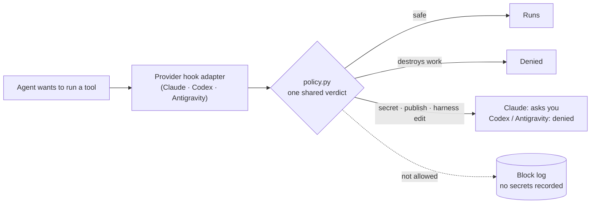

<div align="center">

# Unified Master Harness

**One policy. Six skills. Real safety hooks.**<br>
A shared operating harness for **Claude Code**, **Codex** and **Antigravity**, measured on the real CLIs.

[](https://github.com/egoxx1/unified-master-harness/actions/workflows/ci.yml)
[](LICENSE)
[](#requirements)
[](#requirements)
[](CHANGELOG.md)

**English** · [한국어](README.ko.md)

</div>

---

## Why

Coding agents are capable but inconsistent. The same request can produce a one-line fix or a sprawling
refactor; a test run or a confident "done" with nothing checked; a harmless `git status` or a
`git reset --hard` that discards your work. Each tool also has its own configuration format.

This harness gives all three agents **the same rules** and backs the dangerous parts with **hooks that
each CLI actually executes**:

- **Process that scales with the task.** Small edits stay small; large work starts with acceptance criteria.
- **Verification before "done".** Agents must check their change, and Claude Code warns you when one didn't.
- **Guard rails that hold.** Work-destroying commands, secret files, publishing and self-modification are blocked or require your approval.

## At a glance

| | Claude Code | Codex | Antigravity |
|---|:---:|:---:|:---:|
| Shared policy (`AGENTS.md`) | ✓ via `CLAUDE.md` | ✓ native | ✓ generated mirror |
| Six on-demand skills | ✓ | ✓ | ✓ |
| Blocks work-destroying commands | deny | deny | deny |
| Secret files, publishing, harness edits | ask | deny | deny |
| OS sandbox with secret-file protection | ✓ | workspace sandbox | — |
| Verification warning, compaction memory | ✓ | — | — |

Codex and Antigravity hooks cannot reliably prompt, so anything that needs a human is denied there.

## How it works



| Layer | File | Role |
|---|---|---|
| Product truth | `PROJECT.md` | What the product is and must never break (you write it) |
| Work policy | `AGENTS.md` | How agents size, change, verify and stop (51 lines, ~2,400 tokens) |
| Procedures | `.agents/skills/` | Six skills, loaded only when the task matches |
| Enforcement | `agent-core/hooks/` | One policy, one small adapter per CLI |
| Provider wiring | `.claude/` `.codex/` `.agents/hooks.json` | Hooks, permissions, sandbox |
| Tooling | `agent-core/scripts/` | Install, upgrade, doctor, smoke tests, evals |

## Quick start

```bash
git clone https://github.com/egoxx1/unified-master-harness.git
python3 unified-master-harness/install/apply.py --target /path/to/your-repo            # preview
python3 unified-master-harness/install/apply.py --target /path/to/your-repo --apply --create-project-template
```

Then, in your repository:

```bash
python3 agent-core/scripts/bootstrap_project.py --write   # record commands and ports from evidence
python3 agent-core/scripts/install_git_hooks.py           # block secret files at commit time
python3 agent-core/scripts/doctor.py                      # find user settings that weaken the harness
```

Trust the folder once in Codex (`/hooks`) and Antigravity, then read **[START-HERE.md](START-HERE.md)**.

> **Already have `AGENTS.md`, `CLAUDE.md` or agent settings?** The installer writes nothing and exits
> with code 2. Hand [install/INSTALLATION-PROMPT.md](install/INSTALLATION-PROMPT.md) to an agent to merge
> them by meaning. Your `README.md`, product code and `PROJECT.md` are never touched.

## Measured results

Every number comes from a real run of the scripts in this repository (v4.2.1, October 2026).

| Check | Claude Code 2.1.296 | Antigravity 1.3.3 | Codex CLI 0.161–0.165 |
|---|:---:|:---:|:---:|
| Safety smoke on the real CLI | **6/6** | **6/6** | **8/8**³ |
| Claude-only layer (sandbox, permissions, lifecycle) | **8/8** | — | — |
| Hook runtime without a model | — | — | **PASS**² |
| Skill routing, 12 cases | **12/12** | **12/12** | **12/12**, 3 runs each⁴ |
| CI: macOS + Linux × Python 3.10 / 3.12 / 3.13 | | **6/6 green** | |

⁴ Every case passed in all 3 runs (36/36), Codex CLI 0.165.0, 2026-10-30. ² Real Codex CLI driven by a local stand-in model; a negative
control with the hooks removed fails as expected. ³ v4.3.0 on Codex CLI 0.165.0 with a real model (2026-10-30):
the six shared checks plus the Codex-only `apply_patch` and bare-`bash` probes.

**Cost, stated plainly.** Across 24 Claude Code runs of four small tasks, the harness cost **about 42%
more** than no harness, and every run was correct either way. What the extra buys: on the non-trivial
tasks the agent ran the test suite **9/9** times (0/9 without the harness), and every bug fix left a
regression test (**6/6**, versus 0/6). About 4,900 input tokens per turn are fixed context, roughly half
of it Claude Code's own sandbox instructions. If you prefer fewer tokens, the benchmark page shows which
two switches bring it back to about +20%.

→ [Verification report](docs/VERIFICATION-REPORT.md) · [Benchmark and how to cut the overhead](docs/BENCHMARK.md)

## What gets blocked

<details>
<summary><b>Work-destroying commands</b> (denied on every CLI)</summary>

`git reset --hard`, `git checkout -- .`, `git restore .`, `git switch --discard-changes`,
`git stash clear/drop`, `git clean -f`, force push, `rm -rf` on home or system roots — also when hidden
behind `sh -c`, `eval`, `sudo`, `env`, `xargs`, `timeout` or git global options such as `-C`.
</details>

<details>
<summary><b>Secret files</b></summary>

`.env` and its variants, private keys (`*.pem`, `*.key`, `id_rsa`, ...), `.netrc`, `.pgpass`,
`.git-credentials`, kubeconfig, Docker and GitHub CLI credentials — reading, copying, encoding or
sending them. `.env.example` stays readable.
</details>

<details>
<summary><b>External actions</b></summary>

`git push`, package publishing (`npm publish`, `twine upload`, ...), `gh release`, deploys (Vercel,
Netlify, Fly, Firebase, Wrangler, ...), `terraform apply`, `kubectl apply`, `helm upgrade`, `docker push`,
`aws s3` writes, and destructive database commands.
</details>

<details>
<summary><b>Changes to the harness itself</b></summary>

Shell writes to `AGENTS.md`, `CLAUDE.md`, the hooks, scripts, evals and provider configuration. In
Claude Code, edits through the edit tool ask for your approval.
</details>

## Skills

| Skill | Used when |
|---|---|
| `project-context` | Commands, runtime or layout are unknown or stale |
| `dev-plan` | Large, ambiguous, cross-cutting or product-level work, before coding |
| `dev-debug` | Bugs, failing tests, crashes, regressions |
| `dev-ui-verify` | Any change to how the UI looks or behaves, with depth scaled to the change |
| `dev-verify` | Before claiming any code, config or schema change is complete |
| `dev-review` | On request, or for high-risk changes |

## Tooling

| Command | What it does |
|---|---|
| `install/apply.py` | Installs into a repository; refuses to overwrite existing agent config |
| `agent-core/scripts/upgrade_harness.py` | Upgrades; keeps your edits and writes conflicts as `.v4-new` |
| `agent-core/scripts/doctor.py` | Read-only audit of user settings and tracked secrets |
| `agent-core/scripts/provider_smoke.py` | Runs each real CLI against harmless probes in a disposable repo |
| `agent-core/scripts/codex_hook_probe.py` | Checks Codex hooks with no account or usage |
| `agent-core/scripts/run_evals.py` | Measures whether an agent picks the right skills |
| `bench/run_bench.py` | With/without-harness cost and quality benchmark |

## Requirements

- macOS or Linux (Windows: use WSL; native Windows is untested)
- Python 3.10+ and git. No other dependencies.
- At least one of Claude Code, Codex CLI or Antigravity CLI.

## Status: a verified starting point, not a finished product

Everything above was measured, but some things have not been, and they are listed here on purpose.

1. **The routing eval is lenient.** It checks required and forbidden skills only. Codex passed 36/36 runs,
   yet chose `dev-debug` for a one-line spacing fix in all three runs, which the eval allows. Three Codex-only
   gaps found by reading the Codex source (edits through `apply_patch`, bare shell sessions, hooks that
   fail open) are closed in 4.3.0 and covered by unit tests, not yet by a real-model run.
2. **Large tasks are unmeasured.** The benchmark covers four small tasks; two multi-file tasks (`cart`,
   `listing`) are ready in `bench/tasks.json` but have not been run yet. Multi-file changes and real
   debugging, where process discipline should matter most, have no data yet.
3. **One passing eval run can hide variance.** Repeating a single case six times exposed a failure
   (2 of 6) that one 12-case pass did not show. Other cases may still vary from run to run.
4. **The guard is not a firewall.** It does not see secrets printed through variables, targets passed
   through stdin, or paths built in variables. Code correctness still rests on tests and on the agent's
   own verification and review, which can miss things. The harness makes skipping verification visible,
   not impossible.
5. **No real-world usage data yet.** The Growth Engine improves the harness from block logs and
   retrospectives, which only accumulate through real work.

**The foundation is laid. Train it on your own work and make it yours.** When something gets in your way
or an agent does something odd, record it with `/retro` (Claude Code) or `growth_engine.py`; those
records are the evidence for the next improvement.

## Contributing

Pull requests are welcome. Every policy change needs a test that it blocks and a test that a similar
everyday command still runs; skill changes need eval scores before and after. See
[CONTRIBUTING.md](CONTRIBUTING.md). Report bypasses privately as described in [SECURITY.md](SECURITY.md).

## License and acknowledgements

[MIT](LICENSE). Ideas were adapted from openai/codex, openai/openai-agents-python, vercel/next.js,
obra/superpowers, addyosmani/agent-skills, multica-ai/andrej-karpathy-skills and jbarbier/CLAUDE.md;
pinned revisions are in `agent-core/sources.lock.json`.
